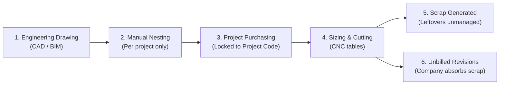
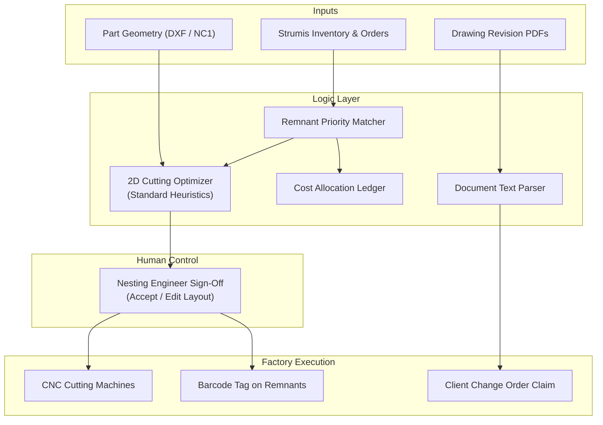

# Case Study: Practical Material Yield and Revision Management
**Client:** Structural Steel Fabricator (80,000 Tonnes / Year)  
**Role:** Forward Deployed Engineer (FDE)  
**Target:** Realistic Waste Reduction and Revision Governance  

---

## 1. Problem Understanding and As-Is Process

### 1.1 Stated Ask vs. Real Need
The client contact (an engineer in Cost Control) asked for artificial intelligence across five areas:
* Nesting optimization
* Drawing revision tracking
* Warehouse and yard storage
* Trailer loading plans
* Vehicle utilization

The client emphasized **nesting**. They reported material waste of **20% to 25% for plates**, **5% to 10% for profiles**, and **7% to 10% overall**.

**The Real Problem:**  
The client does not have a software deficit. The client has three operational gaps:
1. **Unverified Nesting Claims:** The client’s ERP (**Strumis**) already has an automatic nesting feature. The nesting team refuses to use it. The team claims manual nesting saves more steel. Management has no data to test this claim.
2. **Accounting Silos Block Steel Sharing:** Raw steel is bought and charged to specific project codes. When Project A leaves a usable steel remnant (offcut), Project B cannot easily use it. The accounting system has no simple way to transfer costs between project budgets.
3. **Unrecovered Scrap from Drawing Revisions:** Client architects change structural drawings frequently. Late revisions cause already-cut steel to become scrap. The fabricator absorbs these costs because nobody tracks which drawing changes were caused by the client.

---

### 1.2 Stakeholder Analysis

| Stakeholder | Real Objective | Primary Concern | Required Communication |
|---|---|---|---|
| **Cost Control Engineer** | Show cost reduction to senior management. | Avoid conflict with factory teams; lacks nesting software expertise. | "We will provide objective data without disrupting your factory operations." |
| **Executive Management** | Reduce operating costs and eliminate outside trailer rentals. | Wasting money on long software projects that fail. | "Low-risk 12-week pilot. Full payback in under 60 days. Clear stop condition." |
| **Nesting Team** | Maintain daily output and preserve manual craft. | Software that reduces their autonomy or causes machine errors. | "You keep 100% sign-off authority. The software only proposes layouts and finds offcuts." |
| **Engineering / Detailing** | Release fabrication drawings on schedule. | Blame for drafting mistakes. | "The tool flags external client revisions so the company can bill clients for scrap." |
| **Yard & Logistics** | Retrieve steel safely without moving heavy plates multiple times. | Impractical digital rules from people who do not work in the yard. | "Simple barcode labels for offcuts. Dedicated racks. No complex stacking rules." |

---

### 1.3 As-Is Workflow Map



---

## 2. Ranked Discovery Questions (What We Do Not Know)

We must confirm five critical questions on the next call:

1. **Strumis Data Access (Rank 1):**  
   * *Question:* Can we export historical cutting files (DXF/NC1), plate purchases, and scrap records for 20 completed jobs?  
   * *Why it matters:* We must measure real historical scrap before we write code.  
   * *Our Working Assumption:* Strumis contains part geometries and plate purchase records, but offcut records are incomplete.

2. **Nesting Team Participation (Rank 2):**  
   * *Question:* Can the Lead Nesting Engineer join our next working session?  
   * *Why it matters:* A nesting solution fails if the nesting team refuses to use it.  
   * *Our Working Assumption:* The nesting team is protective of their manual routine and will resist black-box tools.

3. **Cost Transfer Policy (Rank 3):**  
   * *Question:* Will company finance permit a standard salvage credit when Project B uses an offcut bought by Project A?  
   * *Why it matters:* If project budgets cannot share material costs, remnant reuse cannot scale.  
   * *Our Working Assumption:* Finance will accept a simple salvage credit (for example: 80% of prime steel price) if overall corporate costs decrease.

4. **Drawing Revision Records (Rank 4):**  
   * *Question:* Where are drawing revisions and client change notices stored today?  
   * *Why it matters:* We must know if change records are in PDF title blocks, formal change orders, or emails.  
   * *Our Working Assumption:* Most drawing change reasons exist as unstructured text in PDF drawing title blocks and emails.

5. **Transport and Equipment Bottleneck (Rank 5):**  
   * *Question:* Why are 13 company trailers under-utilized while outside trailers are hired?  
   * *Why it matters:* Fleet under-utilization is usually caused by dispatch delays or unpainted steel, not poor route planning.  
   * *Our Working Assumption:* The problem is dispatch timing and coating bottlenecks, not vehicle loading geometry.

---

## 3. Solution Strategy and Deliberate Boundaries

### 3.1 Options Evaluated
* **Option 1: Complete Operations AI (Client Wishlist).**  
  * *Verdict:* **Rejected.** Attempting to optimize nesting, yard stacks, trailer loads, and dispatching all at once will fail.
* **Option 2: Computer Vision Yard System.**  
  * *Verdict:* **Rejected.** Cameras in dusty, rainy steel yards fail frequently. Lens dirt and crane shadows cause tracking errors.
* **Option 3: Strumis Remnant and Revision Intelligence Layer.**  
  * *Verdict:* **Selected.** Directly targets the two largest measurable cash losses: unused plate offcuts and unbilled revision scrap.

### 3.2 What We Will Deliberately NOT Build
1. **We will NOT build 3D trailer loading optimization:** The client already has GPS trackers and a booking system that staff do not use. Adding software will not fix empty trailers.
2. **We will NOT build automated yard stacking algorithms:** Crane operators will ignore digital stacking advice when project priorities change daily.
3. **We will NOT replace Strumis:** Replacing an established ERP is expensive, slow, and dangerous for factory operations.
4. **We will NOT use deep learning for cutting geometry:** Neural networks hallucinate and cannot guarantee zero collision between cutting torches and plates. We use exact mathematical algorithms instead.

---

## 4. Solution Engineering: Practical Architecture



### 4.1 System Components
1. **Remnant-First Matching:**  
   Before opening a new steel plate, the software checks existing offcuts in the yard. If parts fit onto an offcut with acceptable yield, the offcut is selected first.
2. **Cross-Project Batching:**  
   The software groups parts by steel grade (e.g., S355JR) and thickness (e.g., 20 mm) across active jobs scheduled for cutting in the next 48 hours. Small parts fill empty gaps between large parts.
3. **Human Sign-Off:**  
   The nesting operator views the layout on screen. The operator can accept the layout or adjust lead-ins and spacing with the mouse. The human keeps final authority.
4. **Inter-Project Cost Ledger:**  
   When Project B uses an offcut from Project A, the software posts a simple credit to Project A and a discounted charge to Project B.
5. **Document Text Parser for Revisions:**  
   A lightweight text-processing model reads revision title blocks on incoming PDF drawings. It identifies changes requested by the client and drafts a commercial claim for scrapped steel.

---

## 5. Evaluation Protocol and Stop Conditions

### 5.1 Test Protocol and Realistic Targets

| Metric | Historical Baseline | Conservative Pilot Target | Measurement Method |
|---|---|---|---|
| **Total Steel Waste** | 7.0% to 10.0% (Reported) | **1.0% absolute reduction** | CNC cut files vs. weighed scrap scale receipts. |
| **Plate Remnant Reuse** | Under 5% of offcuts reused | **At least 25% of offcuts reused** | Strumis barcode check-in and check-out logs. |
| **Revision Recovery** | $0 (All scrap absorbed) | **60% of client design scrap billed** | Accepted client commercial change orders. |
| **Nester Acceptance** | 0% (Auto-nest currently rejected) | **At least 75% algorithmic layouts accepted** | System user logs. |

### 5.2 Clear Kill Criteria (When We Stop the Pilot)
We stop the project and refund remaining fees if:
1. **Historical Benchmark Failure:** The algorithm does not achieve at least **1.0% absolute yield improvement** over manual layouts across 20 historical jobs.
2. **Shop Floor Safety Veto:** The Lead Nesting Engineer shows that proposed cut paths increase torch collisions or thermal plate warping.
3. **Data Access Block:** The client IT team does not provide database exports within 21 days of project start.

---

## 6. Build Plan and 12-Week Timeline

```
┌────────────────────────────────────────────────────────────────────────┐
│                        12-WEEK PILOT SCHEDULE                          │
├─────────────────┬──────────────────────────────────────────────────────┤
│ Weeks 1 to 3    │ Historical Data Audit: Test algorithm on 20 past jobs.│
│                 │ GATE 1: Review verified savings data with management.│
├─────────────────┼──────────────────────────────────────────────────────┤
│ Weeks 4 to 7    │ Software Integration: Connect Strumis read replica.  │
│                 │ Set up remnant barcode labels and accounting ledger. │
├─────────────────┼──────────────────────────────────────────────────────┤
│ Weeks 8 to 11   │ Shadow Production Run: Run 15 live cutting batches   │
│                 │ with nesting engineer sign-off on CNC machines.      │
├─────────────────┼──────────────────────────────────────────────────────┤
│ Week 12         │ Final Review: Reconcile scrap weight and cash value. │
│                 │ GATE 2: Client decision on full operational rollout. │
└─────────────────┴──────────────────────────────────────────────────────┘
```

### Client Dependencies:
* **Week 1:** Provide read-only database export from Strumis.
* **Week 2:** Make Lead Nesting Engineer available for two 1-hour calibration meetings.
* **Week 4:** Finance approval of inter-project offcut salvage pricing.
* **Week 7:** Provide 2 standard barcode label printers in the cutting bay.

---

## 7. Cost, Effort, and Practical Arithmetic

### 7.1 Realistic Client Value (Conservative Arithmetic)
* **Annual Steel Volume:** 80,000 Tonnes.
* **Average Steel Cost:** \$950 / Tonne (practical structural steel composite price).
* **Total Annual Steel Spend:**  
  $$80,000 \times \$950 = \mathbf{\$76,000,000}$$
* **Conservative Steel Savings (1.0% absolute waste reduction):**  
  $$80,000 \text{ Tonnes} \times 0.01 \times \$950/\text{Tonne} = \mathbf{\$760,000 / \text{year}}$$
* **Recovered Client Revision Scrap (Conservative):**  
  $$\approx 200 \text{ Tonnes unbilled client revisions} \times \$950 = \mathbf{\$190,000 / \text{year}}$$
* **Total Realistic Annual Benefit:** **\$950,000 / year.**

### 7.2 Our Delivery Cost
* **Team Required:** 1 Lead FDE (Full-time) + 1 Optimization Engineer (Full-time) for 12 weeks.
* **Internal Loaded Cost:** 2 FTEs $\times$ \$20,000/month $\times$ 3 months = **\$120,000**.
* **Travel and Tools:** **\$10,000**.
* **Total Cost to Deliver:** **\$130,000**.

### 7.3 Proposed Pricing to Client
* **Fixed Pilot Fee:** **\$95,000** payable in three milestone installments (\$35k kickoff, \$30k audit delivery, \$30k pilot completion).
* **Success Fee:** **10% of verified direct steel savings** during Month 4 to Month 12 (capped at \$80,000).
* **Payback Period:** **Under 2 months** of operational use.

---

## 8. Practical Risk Management

| Risk | Likelihood | Impact | Practical Mitigation |
|---|---|---|---|
| **Nesting Team Resistance** | HIGH | HIGH | Keep 100% human sign-off. Encode nester cutting rules into software constraints. |
| **Damaged Yard Offcuts** | MEDIUM | MEDIUM | Only register remnants larger than $1.0\text{ m} \times 0.5\text{ m}$ with clean edges. Inspect upon barcode scan. |
| **Finance Accounting Delay** | MEDIUM | LOW | Use simple standard salvage rates pre-approved by the financial controller. |
| **Dirty Strumis Data** | HIGH | MEDIUM | Clean historical data during Phase 1 benchmark audit before building live connections. |
